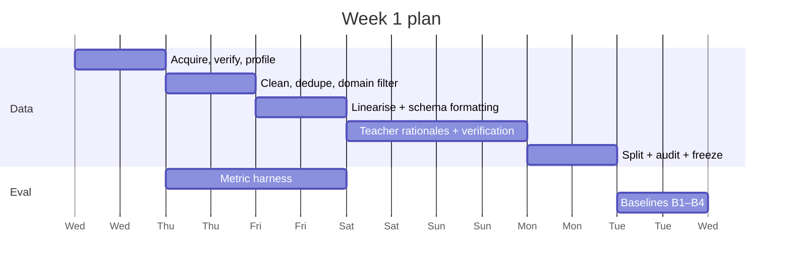
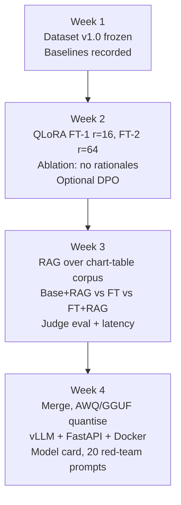

# Week One Deliverable – Track A (ChartQA Dataset)

> **Programme:** IIITK Executive PG Programme in Generative AI and Agentic AI, Capstone
> **Track:** A, "Model-Side" (direct model access, GPU required)
> **Template title:** *Domain-Adapted Assistant: Fine-Tuning and Serving a Small Open LLM for a Regulated Enterprise Workflow*
> **Our working title:** **ChartAudit-7B: an auditable chart question-answering assistant for financial and economic reporting**
> **Week 1 gate (from the template):** dataset frozen + baseline numbers recorded
> **Version:** v1.0, 4 Nov 2026

---

## How to read this document

Every statistic about ChartQA in this document was computed directly from the official question–answer files in the authors' repository (`vis-nlp/ChartQA`, folders `train/`, `val/`, `test/`, files `*_human.json` and `*_augmented.json`). Every requirement quoted from the template comes from the *Capstone Project Templates* PDF. Where something is our own design choice rather than a template rule, it is marked **(our choice)**. Where something needs a supervisor's sign-off, it is marked **⚠ needs confirmation**.

---

## Executive Summary

We have selected **Track A** and propose to build a domain-adapted assistant that answers questions about business charts (bar, line and pie charts from Statista, Pew Research, Our World in Data and OECD) and returns an **auditable, schema-valid answer**: the value, its unit, and the exact table cells it was derived from.

The source dataset is **ChartQA** (Masry et al., *Findings of ACL 2022*). It contains **32,719 question–answer pairs** over roughly 21k charts, each chart shipped with its **underlying data table (CSV)** and a **JSON annotation** (series names, colours, axis labels, chart type).

ChartQA is a strong starting point but it does **not** fit the Track A template out of the box. We found four gaps and have a fix for each:

| # | Gap between raw ChartQA and the template | Our fix |
|---|---|---|
| 1 | Template base models (Llama-3.1-8B-Instruct, Qwen2.5-7B-Instruct, Mistral-7B-Instruct) are **text-only**; ChartQA is image-based. | **Primary route:** feed the model the chart's data table plus visual metadata (colours, series, title) as text. **Stretch route:** a ≤8B vision-language model (⚠ needs confirmation). |
| 2 | Template caps the dataset at **800–2,000 pairs**; ChartQA has 32,719. | Use **only the human-written subset** (9,608 pairs) and draw a stratified, chart-disjoint sample of **1,800 pairs** from it (1,450 train / 170 validation / 180 held-out test). |
| 3 | Template asks for a **regulated enterprise domain**; ChartQA is general-purpose. | Frame it as a **financial and economic reporting assistant** and filter charts by title to economy, finance, trade, labour and health topics. |
| 4 | Template wants **instruction–response pairs with a domain output schema**; ChartQA has a bare question and a one-word answer. | Wrap each item in an instruction and a **JSON output schema** (answer, unit, evidence cells, short rationale), with rationales produced by a teacher model and **kept only when they reproduce the gold answer**. |

By the end of Week 1 we will have: a frozen 1,800-pair dataset with a data card, zero-shot and few-shot baseline numbers for the base model on the 180-item held-out test set, and a working evaluation harness that every later week reuses.

```
            ┌──────────────────────── WEEK 1 OUTPUT (hard gate) ────────────────────────┐
            │                                                                           │
  ChartQA   │   Profile ─► Filter ─► Linearise ─► Format ─► Label ─► Split ─► FREEZE    │──► Week 2: QLoRA
  32,719 QA │      │                                                         │          │
            │      └──────── quality audit + data card ◄─────────────────────┘          │
            │                                                                           │
            │   Base model ─► zero-shot + 3-shot on 180 held-out ─► BASELINE NUMBERS     │──► the bar to beat
            └───────────────────────────────────────────────────────────────────────────┘
```

---

## Problem Statement

### The template's scenario, applied to charts

The template describes a general 7–8B instruct model that "handles the domain poorly: wrong jargon, wrong output schema, inconsistent tone", and asks the team to **adapt it and prove the adaptation worked**.

In financial, risk and compliance teams, a large share of evidence arrives as charts inside reports: market-share bars, inflation lines, budget pies. Analysts have to pull exact numbers from them and justify each number. A general small LLM given a chart's data fails in recognisable ways:

| Failure of the base model | Why it matters in a regulated workflow |
|---|---|
| Arithmetic slips on "difference", "ratio", "average" questions | A wrong figure in a filed report is a compliance issue |
| Answers in prose instead of a fixed schema | Downstream systems cannot parse it |
| Drops or invents units (%, USD bn, million) | Numbers become ambiguous |
| Cannot resolve visual references ("the light-blue bar") | Questions written by humans often refer to colour and position |
| Answers confidently when the chart cannot support an answer | No audit trail; hallucinated figures |

### Problem statement (one sentence)

> *A 7–8B open instruct model, given a business chart's data, cannot reliably return a correct, unit-aware, schema-valid and evidence-cited answer; we will adapt it with parameter-efficient fine-tuning on a curated ChartQA-derived dataset and measure the improvement against a recorded baseline.*

---

## Objectives

### Week 1 objectives (this deliverable)

| ID | Objective | Measurable "done" condition |
|---|---|---|
| O1 | Profile ChartQA fully | Data profile tables in this document, reproducible from a notebook |
| O2 | Build a template-compliant dataset | **1,800** instruction–response pairs; **180** held-out test; zero chart overlap between splits |
| O3 | Define the output schema | JSON schema committed; 100% of training targets validate against it |
| O4 | Audit data quality | 150-item manual audit, gold-label error rate reported |
| O5 | Record baselines | Zero-shot and 3-shot scores for the base model on the 180 held-out items |
| O6 | Freeze and version | Dataset tagged `v1.0-frozen` with SHA-256 checksums and a data card |

### Whole-capstone objectives (Weeks 2–4, from the template)

1. At least **two QLoRA runs with different configurations plus one ablation** (Week 2).
2. Optional **DPO on 200–300 preference pairs** if Week 2 finishes cleanly (Week 2–3).
3. **RAG layer** over a 200–1,000 document corpus, with the comparison *base + RAG vs. fine-tuned vs. fine-tuned + RAG* (Week 3).
4. **Evaluation:** task metric, LLM-as-judge rubric, latency and tokens per second on our own stack (Week 3).
5. **Serving:** merged adapter, quantised (AWQ or GGUF), vLLM behind FastAPI, Docker, plus a model card and a 20-prompt red-team log (Week 4).

---

## Template Requirements and How Track A with ChartQA Aligns

This section answers "what does the template actually ask for?" before we describe the method.

### Track A requirement map

| Template requirement (Track A) | Week | What we will deliver | Status |
|---|---|---|---|
| Dataset of **800–2,000 instruction–response pairs** | 1 | 1,800 pairs | ✅ Compliant after subsampling |
| Allowed sources: **public datasets**, synthetic from a teacher model, or de-identified internal docs | 1 | ChartQA (public) + teacher-generated rationales | ✅ Both are allowed sources |
| **Held-out test set of 150–200** examples, never trained on | 1 | 180 items from ChartQA's official test split, chart-disjoint | ✅ |
| **Baseline:** zero-shot and few-shot of Llama-3.1-8B / Qwen2.5-7B / Mistral-7B Instruct | 1 | Qwen2.5-7B-Instruct (primary) + Llama-3.1-8B-Instruct (comparison) | ✅ |
| **Week 1 hard gate:** baseline recorded, dataset frozen | 1 | `v1.0-frozen` tag + baseline table | ✅ Planned for Day 7 |
| QLoRA/LoRA, ≥2 configs + 1 ablation | 2 | See Future Scope | Planned |
| RAG over 200–1,000 domain documents | 3 | Corpus of chart tables + chart summaries | Planned |
| Task metric + LLM-as-judge + latency/tokens per second | 3 | Relaxed accuracy, EM, schema validity, judge rubric | Defined below |
| Quantise, vLLM + FastAPI, Docker, model card, 20 red-team prompts | 4 | Planned | Planned |
| **Model ≤ 8B, no pretraining, no full fine-tuning** | All | 7B model, QLoRA only | ✅ |
| **Dataset ceiling 2,000 examples** | All | 1,800 | ✅ |
| **Every member runs at least one training job** | 2 | Run allocation table in Week 2 plan | Planned |

### Where ChartQA does *not* align, stated plainly

```
                Template expects                       Raw ChartQA gives
        ┌───────────────────────────────┐      ┌───────────────────────────────┐
        │ narrow regulated domain       │  ≠   │ general web charts            │ ─► domain filter + framing
        │ text instruct model (7–8B)    │  ≠   │ chart images                  │ ─► table linearisation
        │ 800–2,000 pairs               │  ≠   │ 32,719 pairs                  │ ─► stratified subsample
        │ instruction→response + schema │  ≠   │ question→one-word answer      │ ─► JSON schema + rationales
        │ 200–1,000 doc RAG corpus      │  ≈   │ 21k data tables available     │ ─► table corpus (Week 3)
        └───────────────────────────────┘      └───────────────────────────────┘
```

**⚠ needs confirmation:** whether supervisors accept "financial and economic chart reporting" as the "narrow enterprise domain". The template's examples (insurance claim triage, IT helpdesk, KYC, SOP Q&A) are text workflows; ours is closer to a "financial-report question answering" task. We think it is defensible, but it is the single biggest compliance risk, so we ask it explicitly in the confirmation questions.

### How the six template roles map onto Week 1

| Template role | Week 1 owner task |
|---|---|
| Data & synthetic generation | Sampling, linearisation, teacher rationales, split |
| Fine-tuning & tracking | Set up W&B/MLflow project; run baselines through the starter notebook |
| RAG pipeline | Build the Week 3 corpus candidate list from unused charts |
| Evaluation & red-teaming | Metric harness (relaxed accuracy, schema validity), manual audit |
| Serving, quantisation & infra | Verify GPU access, Docker image, vLLM inference for baselines |
| Integration & documentation | Repo structure, data card, this document |

---

## Methodology (Step-by-Step Dataset Preparation Plan)

### Overview

```mermaid
flowchart LR
    A[ChartQA raw<br/>32,719 QA] --> B[1 Acquire & verify]
    B --> C[2 Profile]
    C --> D[3 Clean & dedupe]
    D --> E[4 Domain filter]
    E --> F[5 Linearise table<br/>+ visual metadata]
    F --> G[6 Format as<br/>instruction → JSON]
    G --> H[7 Label: teacher<br/>rationales + verify]
    H --> I[8 Stratified,<br/>chart-disjoint split]
    I --> J[9 Quality audit]
    J --> K[10 Freeze v1.0<br/>+ data card]
    K --> L[11 Baselines]
```



*(If Mermaid does not render in your viewer, the ASCII version in the Executive Summary shows the same flow.)*

### Step 1. Acquire and verify

- Download the full release (with `tables/` and `annotations/` folders) from the Hugging Face mirror linked in the authors' README (`ahmed-masry/ChartQA`), and the QA JSON files from `vis-nlp/ChartQA`.
- Record SHA-256 checksums of every file in `data/raw/MANIFEST.txt`.
- Check that every `imgname` in each QA file has a matching `png`, `csv` and annotation `json`. Log and drop orphans.
- **Licence:** the repository is **GPL-3.0**. Chart images originate from Statista, Pew, OWID and OECD. Record this in the data card and keep the use academic and non-commercial. **⚠ needs confirmation** that this is acceptable for the capstone repository.

### Step 2. Profile (already done, results in *Dataset Evaluation*)

Count pairs, charts, sources, answer types and question types per split. The notebook `01_profile.ipynb` reproduces every number in this document.

### Step 3. Clean and deduplicate

| Check | Rule | Observed in raw data |
|---|---|---|
| Exact duplicates | Same chart + same question (case-insensitive) → keep one | **253** duplicates (230 train-aug, 1 train-human, 12 val-aug, 10 test-aug) |
| Empty labels | Drop | 0 found |
| Answer normalisation | Strip `%`, thousands separators, trailing `.`; lower-case text answers; map `Yes/No` → `yes/no` | Applied to all |
| Malformed questions | Drop if < 3 words or contains no letters | To be logged |
| Table sanity | Drop chart if CSV fails to parse or has < 2 data cells | To be logged |
| Answer-in-table check | For "retrieval" questions, gold answer should appear in the table. Mismatches are flagged for manual review, not silently dropped | To be logged |

### Step 4. Domain filter (our choice)

Keep charts whose **title** (from the annotation JSON) or column headers match a domain lexicon, then sample from those.

```
Domain lexicon (v0, to extend in Week 1):
  finance   : revenue, sales, profit, share, market, price, stock, investment, bank, debt, budget
  economy   : GDP, inflation, unemployment, trade, export, import, income, spending, tax
  health    : hospital, health, mortality, vaccination, insurance, cost
  business  : companies, brands, retail, consumers, advertising, employees
```

If the filter leaves fewer than ~2,500 candidate QA pairs in the human-written subset, we relax it to "any Statista or OECD chart with a numeric axis". The filter rate is reported in the data card.

### Step 5. Linearise the chart into text (primary route)

Base models in the template are text-only, so the model sees the **data table plus the visual metadata** that human questions refer to. The annotation JSON gives series names and colours, which lets us keep "light-blue bar" style questions answerable.

```
Input to the model (illustrative format; question and Air Force row from train_human.json):
──────────────────────────────────────────────────────────────
Chart title: Number of active-duty personnel by branch, by gender
Chart type: vertical bar (grouped)
Series: Male (colour: dark blue) | Female (colour: light blue)
Source: Statista
| Branch      | Male   | Female |
|-------------|--------|--------|
| Air Force   | 49,970 | 13,932 |
| ...         | ...    | ...    |
Question: Can you identify the category in which Male data is 49970
          and female data is 13932?
──────────────────────────────────────────────────────────────
```

*(Visual: a side-by-side figure for the report, with the original chart PNG on the left and the linearised text on the right, showing how the colour legend maps into the "Series" line.)*

Questions that need geometry that the table cannot carry (for example "how many bars are above the 50% gridline" when the chart has no labels) are flagged by a rule-based detector and either kept with the annotation data or excluded. The exclusion rate goes into the data card.

### Step 6. Format as instruction → response

Each pair follows one chat template, so the model learns the schema as well as the answer.

**System prompt (fixed):**
```
You are a chart analyst. Answer questions about the chart data provided.
Return ONLY valid JSON matching the schema. If the data cannot answer the question,
set "answer" to null and explain in "rationale".
```

**Target schema (our choice):**
```json
{
  "answer": "string | number | null",
  "answer_type": "number | text | yes_no | unanswerable",
  "unit": "string | null",
  "evidence": ["Row=Air Force, Col=Male", "Row=Air Force, Col=Female"],
  "rationale": "string, at most 40 words"
}
```

**Example response:**
```json
{
  "answer": "Air Force",
  "answer_type": "text",
  "unit": null,
  "evidence": ["Row=Air Force, Col=Male (49,970)", "Row=Air Force, Col=Female (13,932)"],
  "rationale": "The only row where Male = 49,970 and Female = 13,932 is Air Force."
}
```

### Step 7. Label: teacher rationales with answer verification

ChartQA gives only the final answer. The `evidence` and `rationale` fields come from a larger **teacher model**, which is an allowed source in the template ("synthetic generation from a larger teacher model").

```
          ┌──────────────┐  prompt with table + question + GOLD answer
          │ Teacher LLM  │───────────────────────────────────────────────┐
          └──────────────┘                                               ▼
                                                              ┌────────────────────┐
                                                              │ JSON + rationale   │
                                                              └─────────┬──────────┘
                    ┌───────────────────── verify ──────────────────────┤
                    ▼                       ▼                           ▼
          schema valid?          answer == gold (relaxed)?   evidence cells exist in table?
                    └─────────── all YES ──► keep ─────── any NO ──► retry once, then drop
```

- The gold answer from ChartQA is **never changed** by the teacher. The teacher only explains it.
- Rejection rate is logged. A high rejection rate on a question type is itself a finding (likely noisy gold labels).
- **Unanswerable items (our choice):** about 5% of the training and test sets are built by pairing a question with the *wrong* chart's table. The target is `answer: null`. This trains and measures refusal, which the template's model card section asks for.

### Step 8. Stratified, chart-disjoint split

The template asks for **150–200 held-out test examples never trained on**. We take the test set from ChartQA's **official test split** and the train and validation sets from the official train and val splits, so no chart can appear in two splits.

All three splits use **human-written questions only** (see *Decision: human-written questions only* under Dataset Evaluation).

| Split | Drawn from | Pool available (human-written) | Pairs we take | Of which answerable | Of which unanswerable (built, Step 7) |
|---|---|---|---|---|---|
| **Train** | ChartQA train_human | 7,398 pairs / 3,699 charts | 1,450 | ~1,378 | ~72 (5%) |
| **Validation** | ChartQA val_human | 960 pairs / 480 charts | 170 | ~162 | ~8 |
| **Held-out test (frozen)** | ChartQA test_human | 1,250 pairs / 625 charts | 180 | ~171 | ~9 |
| **Total** | | **9,608** | **1,800** | | |

Even after the domain filter and removal of pure-geometry questions, the human pool is several times larger than what we need, so we can be selective.

```
 1,800 pairs
 ├── Train        ████████████████████████████████████████████████  1,450  (80.6%)
 ├── Validation   ██████                                              170  ( 9.4%)
 └── Test (lock)  ██████                                              180  (10.0%)  ◄ never trained on
```

Stratification keys, in order: **source** (Statista / Pew–OWID / OECD), **answer type** (number / text / yes-no), **question type** (retrieval / arithmetic-comparison / visual-reference) and **chart type** (bar / line / pie). Machine-generated questions are excluded entirely.

Additional evaluation set **(our choice):** we will *also* report on the full official human-written test split (1,250 pairs, "ChartQA-H test"). It is never used for training or model selection. Published ChartQA papers report the human and machine test sets separately, so this number is directly comparable with the literature.

### Step 9. Quality audit

- Two team members independently check **150 random training items**: is the gold answer right, is the rationale faithful, is the schema correct?
- Report the gold-label error rate and inter-annotator agreement (Cohen's κ).
- Items found wrong are corrected or removed, and the change is logged.

### Step 10. Freeze

- Write `data/v1.0/{train,val,test}.jsonl`, checksums, the sampling seed and a **data card** (sources, licence, filters, counts, known biases).
- Git tag `v1.0-frozen`. Any later change creates `v1.1` and invalidates comparisons, so it needs the whole team's agreement.

### Step 11. Baselines (Week 1 gate)

| Run | Model | Prompting | Test set |
|---|---|---|---|
| B1 | Qwen2.5-7B-Instruct | zero-shot, schema in system prompt | 180 held-out |
| B2 | Qwen2.5-7B-Instruct | 3-shot (fixed exemplars from train) | 180 held-out |
| B3 | Llama-3.1-8B-Instruct | zero-shot | 180 held-out |
| B4 | Llama-3.1-8B-Instruct | 3-shot | 180 held-out |
| B5 (optional) | Best of above | 3-shot | 1,250 official human test |

All runs: greedy decoding (temperature 0), max 256 new tokens, served with vLLM, logged to W&B/MLflow with the dataset tag.

### Week 1 day-by-day plan



| Day | Deliverable | Owner role |
|---|---|---|
| 1 | Raw data verified, profile notebook | Data |
| 2 | Clean, deduplicated, domain-filtered candidate pool | Data |
| 3 | Linearised inputs and JSON targets | Data + Integration |
| 2–3 | Evaluation harness (relaxed accuracy, schema validity) | Evaluation |
| 4–5 | Teacher rationales generated and verified | Data + Fine-tuning |
| 6 | Split, audit, data card, `v1.0-frozen` tag | Data + Evaluation |
| 7 | Baselines B1–B4 recorded in tracker | Fine-tuning + Infra |

### Reference code sketches

```python
# Relaxed accuracy, the official ChartQA metric: numeric answers within 5%, else exact match.
def relaxed_match(pred, gold, tol=0.05):
    def num(x):
        try: return float(str(x).replace(",", "").replace("%", "").strip())
        except ValueError: return None
    p, g = num(pred), num(gold)
    if p is not None and g is not None:
        return p == g if g == 0 else abs(p - g) / abs(g) <= tol
    return str(pred).strip().lower() == str(gold).strip().lower()
```

```python
# Chart-disjoint split: sample by chart, never by question.
import random
def sample_by_chart(qa, n_target, seed=42):
    charts = sorted({x["imgname"] for x in qa})
    random.Random(seed).shuffle(charts)
    out = []
    for c in charts:
        out += [x for x in qa if x["imgname"] == c]
        if len(out) >= n_target: break
    return out[:n_target]
```

---

## Dataset Evaluation (ChartQA)

### Size and splits (computed from the official files)

| Split | Human-written (ChartQA-H) | Machine-generated (ChartQA-M) | Total QA | Charts (H / M) |
|---|---|---|---|---|
| Train | 7,398 | 20,901 | **28,299** | 3,699 / 15,474 |
| Val | 960 | 960 | **1,920** | 480 / 680 |
| Test | 1,250 | 1,250 | **2,500** | 625 / 987 |
| **Total** | **9,608** | **23,111** | **32,719** | |

```
QA pairs by split (each █ ≈ 1,000 pairs)
Train  ████████████████████████████  28,299
Val    ██                             1,920
Test   ██▌                            2,500
```

### Answer-type mix

| Subset | Numeric | Yes/No | Text (entity/label) |
|---|---|---|---|
| Train, human | 68.9% | 8.0% | 23.0% |
| Train, machine | 84.9% | 0.0% | 15.1% |
| Test, human | 66.8% | 8.3% | 24.9% |
| Test, machine | 86.4% | 0.0% | 13.6% |

```
Answer types, train human (n=7,398)
Numeric  ██████████████████████████████████▌  68.9%
Text     ███████████▌                          23.0%
Yes/No   ████                                   8.0%
```

**Reading:** this is overwhelmingly a **numeric** task, which suits a finance/reporting framing and makes a tolerance-based metric essential.

### Question difficulty (keyword-based estimate, our analysis)

| Subset | Mentions a colour | Refers to chart structure (bar, line, slice, leftmost…) | Arithmetic / comparison cue (difference, sum, ratio, average…) |
|---|---|---|---|
| Train, human | 17.5% | 36.4% | 40.4% |
| Train, machine | 0.6% | 0.9% | 12.7% |
| Test, human | 16.3% | 37.8% | 39.8% |
| Test, machine | 0.7% | 0.8% | 12.0% |

```
Arithmetic/comparison questions
Human    ████████████████████  40%
Machine  ██████                 13%

Visual-reference (colour) questions
Human    █████████              17%
Machine  ▏                      <1%
```

**Reading:** the human-written half is much harder (more arithmetic, many visual references). The machine half is mostly simple lookup. This is why we use only the human-written questions, and why we put colour and series information into the linearised input.

### Source coverage (train + val, human-written)

| Source | QA pairs | Share | Notes |
|---|---|---|---|
| Statista | 4,322 | 51.7% | Business, markets, consumer data. Strongest domain fit |
| Pew Research / Our World in Data | 3,646 | 43.6% | Social, health, economic indicators |
| OECD | 390 | 4.7% | Economic indicators. Excellent fit but small |

The machine-generated subset comes **only from Statista** charts.

### Decision: human-written questions only

We use **only ChartQA-H** (the human-written questions) for train, validation and test, and drop the machine-generated ChartQA-M subset.

| | Human-written (ChartQA-H) | Machine-generated (ChartQA-M) |
|---|---|---|
| Pairs (train / val / test) | 7,398 / 960 / 1,250 | 20,901 / 960 / 1,250 |
| Arithmetic or comparison questions | ~40% | ~13% |
| Questions mentioning a colour | ~17% | <1% |
| Sources | Statista, Pew/OWID, OECD | Statista only |
| Exact duplicates | 1 | 252 |
| Who wrote them | Crowd workers, written the way a person asks | Generated from Statista chart summaries, mostly simple lookups |

**Why this works for the template:** the template only needs 800–2,000 pairs and a 150–200 test set. The human subset alone has 9,608 pairs, more than four times what we need, and its own official test split for the frozen 180.

**What we gain:** harder and more realistic questions (closer to how an analyst asks), more source diversity, almost no duplicates, and a weaker baseline, which leaves more room to show a fine-tuning gain.

**What we give up, and how we handle it:**

| Trade-off | Mitigation |
|---|---|
| More questions depend on how the chart looks (~36% mention bars, lines, slices or position) | Put colours and series names from the annotation JSON into the input; flag and exclude pure-geometry questions and report how many |
| Pew charts have hand-made annotations that the authors call noisy | Manual audit focuses on Pew items; drop charts whose table or annotation fails to parse |
| Baseline and absolute scores will look lower than papers' averages that include ChartQA-M | Always report against the human test numbers, never the combined average |
| Fewer easy lookup questions to teach the output schema | The schema is learned from every item regardless of difficulty; 1,450 training items is enough for format learning |

### Quality findings

| Dimension | Finding | Impact | Mitigation |
|---|---|---|---|
| Duplicates | 253 exact duplicate (chart, question) pairs | Minor leakage within a split | Deduplicate (Step 3) |
| Label noise | Authors note the annotations (bounding boxes) are "a bit noisy"; Pew charts were annotated manually | Colours or series names may be wrong for some charts | Manual audit of 150 items; drop charts whose table fails to parse |
| Visual dependence | ~36% of human questions refer to chart structure | Some are unanswerable from a table alone | Include annotation metadata; flag and exclude pure-geometry questions |
| Answer format | Mix of `"14"`, `"0.57"`, `"Yes"`, entity names | Exact match would be unfair | Normalisation + relaxed accuracy |
| Output schema | None in raw data | Template wants a domain schema | JSON schema + teacher rationales (Steps 6–7) |
| Domain | General web topics | Template wants a narrow enterprise domain | Domain filter + framing (Step 4) ⚠ |
| Licence | GPL-3.0 repository; third-party chart sources | Redistribution conditions | Academic use only; cite; data card |

### Compliance verdict

| Template criterion | Raw ChartQA | After our pipeline |
|---|---|---|
| Public or allowed source | ✅ | ✅ |
| 800–2,000 pairs | ❌ (32,719) | ✅ (1,800) |
| 150–200 held-out test | ❌ (2,500, not frozen for us) | ✅ (180, frozen) |
| Instruction–response format | ❌ | ✅ |
| Domain output schema | ❌ | ✅ |
| Text input for the listed base models | ❌ (images) | ✅ (linearised tables) |
| Narrow enterprise domain | ⚠ partial | ⚠ likely, pending supervisor confirmation |
| RAG corpus available for Week 3 | ✅ (21k tables) | ✅ |

---

## Measurement & Metrics

### What supervisors will see

```
┌───────────────────────────── RESULTS SCOREBOARD (one page in the report) ─────────────────────────────┐
│ Model                       │ Relaxed Acc │ Schema valid │ Unit correct │ Refusal F1 │ Judge (1–5) │ tok/s │
│─────────────────────────────┼─────────────┼──────────────┼──────────────┼────────────┼─────────────┼───────│
│ B1 Qwen2.5-7B zero-shot     │     ...     │     ...      │     ...      │    ...     │     ...     │  ...  │
│ B2 Qwen2.5-7B 3-shot        │     ...     │     ...      │     ...      │    ...     │     ...     │  ...  │
│ FT-1 QLoRA r=16             │   (Wk 2)    │              │              │            │             │       │
│ FT-2 QLoRA r=64             │   (Wk 2)    │              │              │            │             │       │
│ Ablation (no rationales)    │   (Wk 2)    │              │              │            │             │       │
│ Base + RAG                  │   (Wk 3)    │              │              │            │             │       │
│ FT + RAG                    │   (Wk 3)    │              │              │            │             │       │
│ FT, quantised AWQ           │   (Wk 4)    │              │              │            │             │       │
└─────────────────────────────────────────────────────────────────────────────────────────────────────────┘
```

*(Visual for the report: a grouped bar chart of relaxed accuracy per model, broken down by question type, with retrieval, arithmetic and visual-reference as groups. Baselines in grey, fine-tuned runs in one accent colour.)*

### Metric definitions

| Metric | Definition | Template link | Week 1 target |
|---|---|---|---|
| **Relaxed accuracy** (primary) | Numeric answer within ±5% of gold, otherwise case-insensitive exact match. This is ChartQA's official metric | "Task metric (exact match / F1…)" | Baseline recorded |
| **Exact match** | Strict string match after normalisation | Task metric | Baseline recorded |
| **Schema validity** | % of outputs that parse as JSON and validate against the schema | "schema validity" (named in template) | Baseline recorded |
| **Unit correctness** | % of numeric answers with the correct unit field | Domain-specific | Baseline recorded |
| **Evidence precision** | % of cited cells that exist in the table and contain the values used | Auditability | Baseline recorded |
| **Refusal F1** | F1 on the unanswerable items (answer = null) | Model card: refusal behaviour | Baseline recorded |
| **LLM-as-judge** | 1–5 rubric: correctness, faithfulness of rationale to evidence, format, tone. Judge model larger than ours, blinded to model identity | "LLM-as-judge rubric on the held-out set" | Rubric frozen in Week 1 |
| **Latency and tokens/s** | p50/p95 latency and throughput on our vLLM stack | "latency plus tokens-per-second" | Measured on baseline |
| **Breakdowns** | All of the above by question type, source and chart type | Technical rigour | Reported |

### Dataset-quality metrics (Week 1 specific)

| Metric | Target |
|---|---|
| Chart overlap between train/val/test | **0** |
| Exact duplicates after cleaning | **0** |
| Teacher rationale acceptance rate | Report the rate (expected 70–90%) |
| Gold-label error rate in 150-item audit | Report; below 5% is healthy |
| Inter-annotator agreement (κ) | ≥ 0.7 |
| Schema-valid training targets | **100%** |

### Success criteria for the whole capstone (proposed)

- Fine-tuned model beats the best baseline by **≥ 10 points relaxed accuracy** on the 180 held-out items.
- Schema validity **≥ 98%**.
- Gains hold on the 1,250-item official human test, which shows we did not overfit the 180.
- Quantised model loses **≤ 2 points** versus the unquantised fine-tuned model.

---

## Differentiation & Innovation

Most Track A teams will pick a text domain (helpdesk, claims, SOPs) and fine-tune on generated Q&A. Our points of difference:

| # | Innovation | Why it stands out |
|---|---|---|
| 1 | **Structured-data reasoning, not just text** | Charts and tables are where small LLMs are weakest at arithmetic; the gain is easier to show and easier to explain |
| 2 | **Auditable output**: evidence cells + rationale in a strict schema | Matches what a regulated workflow actually needs; schema validity is measurable |
| 3 | **Visual-metadata-aware linearisation** | Uses the annotation JSON so "light-blue bar" questions stay answerable for a text-only model |
| 4 | **Verified teacher rationales** (keep only if they reproduce the gold answer) | Synthetic data with a correctness check, plus a clean ablation: *with vs. without rationales* |
| 5 | **Built-in refusal set** (unanswerable items) | Directly feeds the model card's refusal section and red-team log |
| 6 | **Human-written data only, plus external comparability** | We train and test only on the harder, human-authored questions, and report on the full 1,250-item human test so supervisors can compare with published chart models |
| 7 | **Open-domain chart QA for RAG** (Week 3) | The question arrives without the chart; the system must first retrieve the right table from a report corpus. A natural RAG use, not a bolted-on one |
| 8 | **Optional multimodal track** | A ≤8B vision-language model on the same data gives a text-vs-vision comparison few teams will have |

```
                   Typical Track A project              ChartAudit-7B
  Input            free text                     ──►    tables + visual metadata
  Output           free text                     ──►    JSON with evidence cells
  Data             teacher Q&A                   ──►    real QA + verified rationales
  Safety           generic refusals              ──►    measured refusal F1
  Benchmark        team-made only                ──►    team test + public benchmark
```

---

## Future Scope

### Weeks 2–4 (within the capstone)



| Week | Plan |
|---|---|
| **2** | QLoRA on Qwen2.5-7B-Instruct. **FT-1:** rank 16, lr 2e-4, attention projections. **FT-2:** rank 64, lr 1e-4, all linear layers. **Ablation:** FT-1 config trained on answer-only targets (no rationale or evidence) to isolate the value of rationales. Six members each own at least one run (seeds, epochs, extra configs). |
| **2–3 (stretch)** | DPO on 200–300 preference pairs: chosen = verified correct JSON, rejected = the model's own wrong or schema-broken output from the validation set. |
| **3** | RAG corpus of **~800 documents**: data tables plus titles from unused ChartQA charts, optionally with human-written chart summaries from the Chart-to-Text dataset (Statista/Pew). Documented decisions: chunk = one table (or row groups for large tables), embedding model (e.g. `bge-base`), cross-encoder reranker. Required comparison: base + RAG vs. FT vs. FT + RAG. |
| **4** | Merge adapter, quantise to AWQ (vLLM) and GGUF (CPU demo), FastAPI `/ask` endpoint with schema-validated responses, Docker, model card, red-team log (prompt injection in table cells, out-of-scope financial advice, fabricated-number requests). |

### Beyond the capstone

1. **Multi-modal extension:** fine-tune a ≤8B vision-language model (e.g. Qwen2.5-VL-7B) directly on chart images and compare with the text route on the same 180 items.
2. **Harder benchmarks:** ChartQAPro (the authors' newer, more diverse benchmark), PlotQA, and charts from real annual reports and central-bank publications.
3. **Chart-to-table front end:** add an image-to-table step (e.g. DePlot-style) so the text model works on raw images in production.
4. **Program-of-thought:** have the model emit a short Python expression over table cells, executed in a sandbox, for exact arithmetic.
5. **Scaling the data:** grow beyond the 2,000 cap, first with the remaining human-written pairs, then test whether adding the 20,901 machine-generated pairs helps or hurts, and plot a learning curve.
6. **Enterprise integration:** PDF report ingestion, an analyst review UI, and human-in-the-loop sign-off for numbers that go into filings.

---

## Conclusion & Next Steps

ChartQA is a **viable and competitive** basis for Track A, **provided** we (a) subsample the human-written questions to the template's 2,000-pair ceiling with a 180-item frozen test set, (b) convert charts to text so the listed 7–8B instruct models can use them, (c) add a domain output schema with verified rationales, and (d) get supervisor sign-off on the financial/economic reporting framing as our "enterprise domain". The raw data profile supports this: two-thirds of answers are numeric, about 40% of human questions need arithmetic or comparison, and every chart ships with its data table, so the task is hard enough for a base 7B model to show a clear, measurable gain.

### Immediate next steps

| # | Action | Owner role | By |
|---|---|---|---|
| 1 | Send the confirmation questions below to the supervisor | Integration | Day 1 |
| 2 | Download full release with tables and annotations; checksums | Data | Day 1 |
| 3 | Build metric harness and JSON schema validator | Evaluation | Day 3 |
| 4 | Linearisation + domain filter + formatting | Data | Day 3 |
| 5 | Teacher rationales with verification | Data + Fine-tuning | Day 5 |
| 6 | Split, 150-item audit, data card, `v1.0-frozen` | Data + Evaluation | Day 6 |
| 7 | Baselines B1–B4 in W&B/MLflow | Fine-tuning + Infra | Day 7 (gate) |

### Proposed repository layout

```
chartaudit/
├── data/
│   ├── raw/                 # ChartQA download + MANIFEST.txt (checksums)
│   ├── interim/             # cleaned, filtered, linearised
│   └── v1.0/                # train.jsonl, val.jsonl, test.jsonl (FROZEN), DATA_CARD.md
├── notebooks/
│   ├── 01_profile.ipynb
│   └── 02_build_dataset.ipynb
├── src/
│   ├── linearise.py
│   ├── schema.py            # JSON schema + validator
│   ├── teacher_label.py
│   ├── split.py
│   └── metrics.py           # relaxed accuracy, refusal F1, evidence precision
├── eval/
│   ├── run_baseline.py
│   └── judge_rubric.md
├── configs/                 # QLoRA run configs (Week 2)
└── reports/week1/           # this document + baseline table
```

---

## Confirmation Questions

1. Are we on right path for track selection? Or there can be more choices to explore.
2. If this proposal is good to go then what are the things I need to consider and how to start step by step?
3. Does the dataset meet all the requirements asked in the template?
4. How are we going to measure and show the result to supervisors?
5. Will this help us stand out compared to others or is there anything else that needs to be done?
